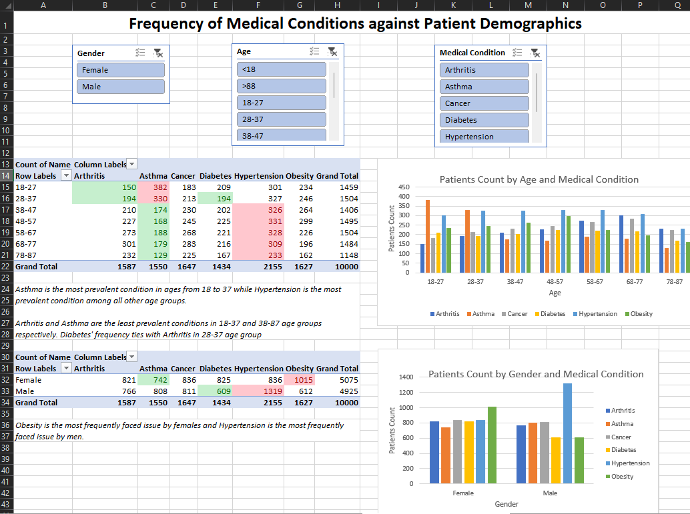
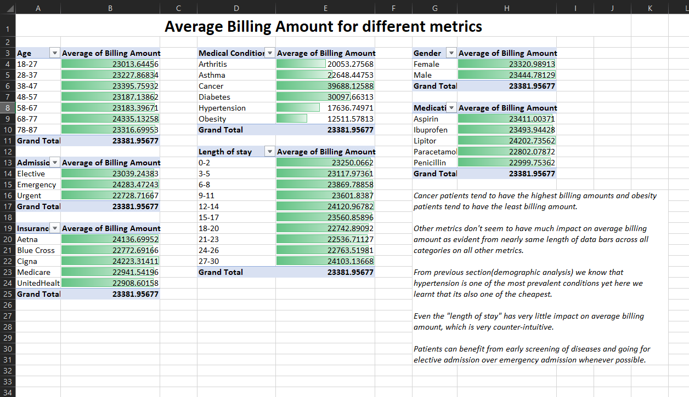
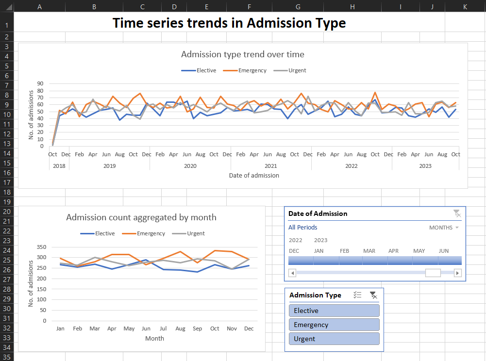
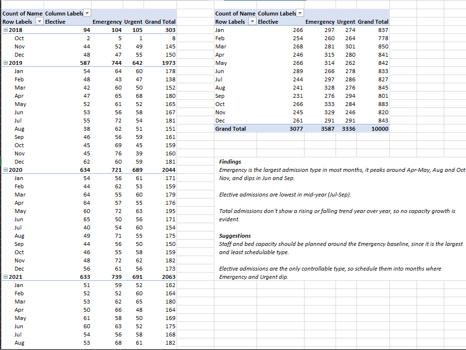

# US Healthcare Analysis (Excel)

Excel analysis of 10,000 US patient records covering demographics, medical conditions, admission patterns and billing.

**Interactive view:** [Open in Excel for the web](https://1drv.ms/x/c/87eada7c807d6d4f/IQBwFwEOaR7tSICKgd53PAl3AY5T1Uyp7WWlaZbrkj_xk1Y?e=B41YTe)

## Objectives

1. Demographic analysis: how medical conditions are distributed across age groups and gender.
2. Price optimization: which patient and admission factors influence average billing amount.
3. Resource management: how admission types trend over time, to inform staffing and bed planning.

## Dataset

10,000 patient records with 16 columns: Name, Age, Gender, Blood Type, Medical Condition, Date of Admission, Doctor, Hospital, Insurance Provider, Billing Amount, Room Number, Admission Type, Discharge Date, Medication, Test Results, plus a computed Length of Stay column. All work is in `da_healthcare_excel.xlsx` (raw data, cleaned data and one analysis sheet per task).

## Data cleaning

- Standardized inconsistent entries: `Emer` -> `Emergency` in Admission Type (54 rows) and `M` -> `Male` in Gender (120 rows).
- Fixed letters typed in place of digits: `I` -> `1` in Age (158 rows) and `O` -> `0` in Billing Amount (11 rows).
- Normalized Medical Condition casing with `PROPER()`.
- Converted text dates carrying a weekday prefix into real dates in Date of Admission and Discharge Date.
- Imputed missing Billing Amount values with the median billing amount of the patient's medical condition (median table + `VLOOKUP`).

## Project structure

- `da_healthcare_excel.xlsx`: cleaned data and analysis sheets
- `assets/`: screenshots used in this README
- `README.md`

## Analysis

### 1. Frequency of medical conditions across demographics

**Approach:** Pivot tables counting patients by age bucket (ten-year buckets, 18–87) and by gender against each medical condition, with column charts and slicers for gender, age and medical condition. In the tables, red marks the most frequent condition and green the least frequent.

**Findings:**

- Asthma is the most frequent condition for ages 18–37; Hypertension is the most frequent in every older age group.
- Arthritis is the least frequent condition for ages 18–37 (tied with Diabetes at 28–37); Asthma is the least frequent for ages 38–87.
- Obesity is the most frequent condition among females (1,015 patients) and Hypertension among males (1,319).

### 2. Average billing amount across metrics

**Approach:** Pivot tables of average billing amount by age, gender, medical condition, admission type, insurance provider, medication and length of stay, with data bars for side-by-side comparison. The overall average is 23,381.96.

**Findings:**

- Medical condition is the only metric with a large spread: Cancer has the highest average billing (39,688) and Obesity the lowest (12,512).
- Averages by age, gender, admission type, insurance provider, medication and length of stay all stay within roughly 22,500–24,300.
- Hypertension is the most frequent condition overall (Task 1) yet has the second-lowest average billing (17,637).
- Length of stay has almost no effect on average billing.
- Emergency admissions average about 5% more than elective ones (24,283 vs 23,039), so early screening and elective admission may help reduce costs.

### 3. Time series trends in admission type

**Approach:** A pivot table of admission counts by admission type and month (Oct 2018 – Oct 2023) feeding a line chart, plus a second pivot aggregating counts by calendar month across all years to isolate seasonality. Timeline and admission type slicers filter both. Oct 2018 is a partial month (8 admissions) and is kept in the data.

**Findings:**

- Emergency is the largest admission type in most months. It peaks around April–May, August and October–November, and dips in June and September.
- Elective admissions are lowest in mid-year (July–September).
- Total admissions show no rising or falling trend year over year, so there is no evidence of growing capacity needs.

**Suggestions:**

- Plan staff and bed capacity around the Emergency baseline, since it is the largest and least schedulable admission type.
- Elective admissions are the only controllable type, so schedule them into months where Emergency admissions dip (June and September).

## Key findings

- Condition mix shifts with age: Asthma leads below 38, Hypertension from 38 onward (Task 1).
- Medical condition is the main driver of billing amount; the other metrics barely move it (Task 2).
- Emergency admissions dominate and follow a seasonal pattern, with no year-over-year growth in total admissions (Task 3).
